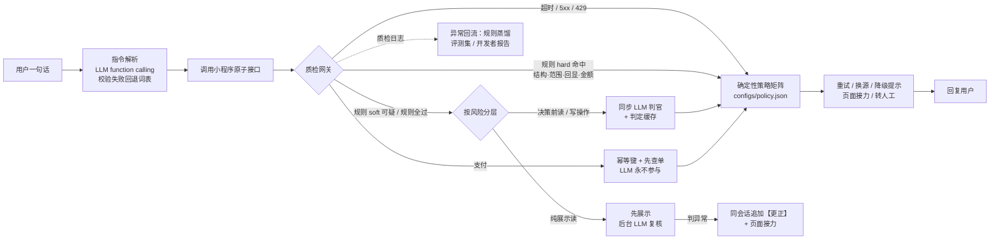
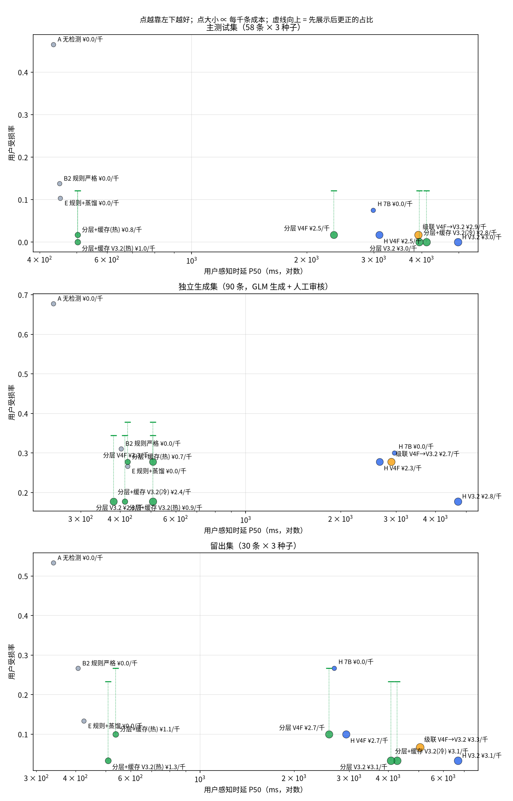

# 设计文档｜「异常检测兜底 Agent」：微信 AI 助手调用小程序时的工具返回质量网关

> 个人作品集项目，为投递「腾讯 WXG｜AI 产品经理」而做。**不是**微信或任何腾讯团队的生产系统，也没有使用任何内部数据。
> 5 个小程序接口全部是模拟的，数据是合成的（synthetic）。文中凡是标「假设」的数字都是推演用的参数，不是事实；凡是标「实测」的数字都来自本仓库 `eval/` 下的实际运行（2026-11-15，Asia/Shanghai）。

---

## 一页摘要

**问题。** 微信 AI 助手（小微）通过「小程序 MCP 协议」调用海量小程序的原子接口。超时用户看得见；**接口返回成功但数据错了**（单位错、串城市、别家菜单、缓存过期），Agent 会用笃定的语气把错误包装成可信的答案。平台现有的问题发生率、灰度、离场机制都是按 3 天周期的事后治理，缺一层「会话内、用户看到之前」的实时拦截。

**方案。** 在编排层加一道质检网关：**规则拦确定性问题（零成本）→ LLM 判规则写不出来的语义问题 → 确定性策略矩阵决定重试 / 换源 / 降级提示 / 页面接力 / 转人工**。LLM 只分类不决策；支付永远不盲重试（幂等键 + 先查单）。时延上按风险分层：纯展示的读接口「先展示、后台复核、错了发【更正】」，决策前和写操作才同步等 LLM，再加一层判定缓存。

**结果（实测，用户受损率 = 错误数据被当事实展示 + 重复扣款/下单的指令占比，越低越好；方括号为 95% bootstrap 区间）：**

| 测试集 | 无检测 | 仅规则（严格） | 规则 + LLM（DeepSeek-V3.2） | 说明 |
|---|---|---|---|---|
| 主测试集 58 条 × 3 种子 | 0.466 | 0.138 | **0.000** [0.000, 0.000] | 自建；prompt v2 样本内调参，满分不代表泛化 |
| 留出集 30 条 × 3 种子 | 0.533 | 0.267 | **0.033** [0.000, 0.100] | 写完 prompt v2 后另写 |
| **独立生成集 90 条** | 0.678 | 0.311 [0.222, 0.411] | **0.178** [0.100, 0.267] | **另一个模型家族（GLM-4.5-Air）生成 + 人工审核**，最可信也最难 |
| 随机压测 300 会话（10% 故障率，假设） | 8.7% | 1.7%（但误兜底 28%） | **0.3%**（误兜底 0%） | 更接近线上「大部分请求正常」的形态 |

- **混合方案在三套测试集上都显著好于仅规则**，独立生成集上受损率从 0.311 降到 0.178，正常放行率从 0.793 升到 0.897。但独立集也说明：面对没见过的错误形态，召回只有 0.738，离「上线就能兜住」还远。
- **时延：** 同步混合方案 P50 约 5 秒（V3.2）——这是原型最大的问题。分层 + 判定缓存后，压测流量下 P50 **0.32 秒**（同步混合 4.6 秒），模型费用降 56%，代价是 1.3% 的会话先展示后更正。决策前 / 写操作路径仍是秒级，必须靠蒸馏的小模型解决（下一步）。
- **级联（小模型先判、拿不准再升级）没有带来收益**：7B 的「正常」判断不可信，级联反而封顶了召回；V4-Flash 判「正常」时几乎总给 ≥0.9 的置信度（三套测试集 × 3 种子里只有 9 次因低置信升级），漏掉的恰恰是它很自信放行的样本。结论：**异步化之后判官的时延不再是体验成本，应该用最强的模型；只有同步路径才需要快模型——这正是蒸馏的价值**。
- **指令解析：** LLM function calling（V4-Flash）在 124 条解析集上 124/124 完全正确，词表规则在 36 条口语化改写上只有 12/36；保留词表做兜底。
- **成本：** 公网 API 标价下同步混合约 ¥3 / 千会话，分层 + 缓存约 ¥1.3 / 千会话；本项目两轮开发全部模型花费约 ¥3.6（有日志）。

**最大的局限。** 环境是模拟的；独立集虽然换了生成模型并人工审核，但审核人和系统设计者是同一方；时延里的服务部分是虚拟毫秒。下一步需要真实 Trace 标注（§16、§17）。

---

## 架构



---

## 1. 市场背景：为什么现在做这个（有出处的事实）

| 事实 | 出处 |
|---|---|
| 2026 年 6 月 20 日前后，微信原生 AI 助手「小微」开始灰度，支持用文字或语音操作微信原生功能，涵盖点外卖等场景；美团、滴滴、携程、京东等服务已率先接入；微信支付推出「AI 专属卡」，关键步骤仍需用户确认。 | [钛媒体](https://www.tmtpost.com/8035830.html) |
| 实测报道：小微在 8.0.75 版本里小范围灰度；微信里的 AI 交互是碎片化即时需求，「用户的耐心只有几百毫秒」；涉及发消息、发红包等资产相关操作都会要求用户确认。 | [腾讯新闻](https://news.qq.com/rain/a/20260623A096JV00) |
| 小程序 AI 开发模式：开发者把小程序功能抽象成原子接口，封装成 SKILL；小微通过「小程序 MCP 协议」选择原子接口完成任务。一个小程序最多声明 30 个 SKILL。原子接口返回里有 `isError`、`content`、`structuredContent` 等字段。 | [接入指南](https://developers.weixin.qq.com/miniprogram/dev/ai/guide.html)、[接入方式](https://developers.weixin.qq.com/miniprogram/dev/ai/integration.html?lang=en) |
| 平台用「问题发生率」衡量 SKILL 线上质量：问题发生率 = 因开发者原因导致的 SKILL 问题会话数 ÷ 线上调用开发者 SKILL 的所有会话数，**超过 20% 即超标**。 | [使用前必读](https://developers.weixin.qq.com/miniprogram/dev/ai/launch-and-exit/must-read.html) |
| 首次上线按 10% → 30% → 60% → 100% 灰度，每 3 天一个周期，单周期问题发生率 ≤ 20% 才升一级。 | [上线须知](https://developers.weixin.qq.com/miniprogram/dev/ai/launch-and-exit/launch-guidelines.html) |
| 连续三个周期问题发生率 > 20%、版本评分不达标、且真实会话 ≥ 50 条时触发「离场」，小微不再调用。 | [离场须知](https://developers.weixin.qq.com/miniprogram/dev/ai/launch-and-exit/exit-guidelines.html) |
| 评测四项指标：服务交付、交互体验、性能质量、场景覆盖。「接口网络请求是否超时」**暂时只展示、不计分**；文档质量要求涉及下单支付等敏感操作时不能漏掉用户确认。 | [评测报告说明](https://developers.weixin.qq.com/miniprogram/dev/ai/evaluation/report.html) |
| 2026-11-11 开放微信评测和代码提审；2026-10-29 We分析新增「故障排查」，展示因开发者原因出现问题的会话；2026-07-03 起 `wx.requestPayment` 等接口不再支持在原子接口内调用。 | [更新日志](https://developers.weixin.qq.com/miniprogram/dev/ai/changelog.html) |
| 规模：微信及 WeChat 合并月活 14.02 亿（2025-03-31）；小程序月活约 9.46 亿（QuestMobile，2025 年 5 月）；腾讯官网披露的小程序日活 6 亿是 2022 年三季度口径。 | [腾讯 2025Q1 业绩](https://static.www.tencent.com/uploads/2025/05/14/01ce3b69d840860f44c0fc7ebca99ee3.pdf)、[QuestMobile via 澎湃](https://www.thepaper.cn/newsDetail_forward_31182921)、[腾讯官网](https://www.tencent.net.cn/zh-cn/products/weixin-wechat/) |
| 学术参照：τ-bench 显示最强的函数调用 Agent（如 gpt-4o）任务成功率不到 50%，零售场景 pass^8 低于 25%，即同一任务重复 8 次全对的概率很低。 | [τ-bench, arXiv:2406.12045](https://arxiv.org/abs/2406.12045) |

**从这些事实里读出的三个信号：**

1. **平台已经把「质量」做成了准入和退出机制**（评测分、问题发生率、灰度、离场）。这说明平台最关心的不是「接进来多少小程序」，而是「接进来的能不能稳定交付」。
2. **平台现有指标偏「事后」和「开发者侧」**：问题发生率按 3 天周期统计，用来决定灰度和离场；但在**单次会话里**，用户已经看到了错误结果。缺的是一层「会话内、用户看到之前」的实时拦截。这正是本项目要补的位置。
3. **网络超时在评测里暂不计分**，而真正决定体验的「数据对不对」（服务交付、文字有效性）才是重点。这和本项目的判断一致：重点不在重试，而在语义质检。

> 说明：以上是我根据公开文档做的推断。微信内部是否已有类似模块、如何实现，我不知道，也没有假装知道。

---

## 2. 问题定义：Agent 调用海量小程序，难在哪

| 难点 | 为什么 Agent 时代更严重 |
|---|---|
| **供给长尾、质量参差** | 头部服务（美团、滴滴）有 SRE；长尾小程序的接口可能缓存过期、字段写错、单位写错（分和元）。Agent 把它们放在同一个入口里，用户分不清是谁的问题，只会觉得「小微不靠谱」。 |
| **错误被语言包装** | 传统 App 里，价格显示 0 元，用户一眼看出 bug。Agent 回答「黄焖鸡米饭 258 元，约 32 分钟送达」，语气笃定，用户更容易信。**Agent 放大了错误数据的可信度。** |
| **多步链路误差累积** | 查菜单 → 下单 → 支付，三步各 97% 正确，整条链路只有约 91% 正确（0.97³，纯算术示意）。 |
| **不可逆动作** | 支付、下单是写操作。超时以后「到底扣没扣」是未知状态，SDK 式盲重试会重复扣款。 |
| **即时性要求** | 用户耐心只有几百毫秒（见上表腾讯新闻）。质检本身不能把体验拖垮。 |

---

## 3. STP：用户是谁

### 3.1 细分（Segmentation）

| 角色 | 细分 | 和本问题的关系 |
|---|---|---|
| **C 端用户** | 信息查询型（天气、路线、菜单），交易型（点外卖、打车、支付） | 直接承受错误；交易型损失更大（钱、时间） |
| **小程序开发者** | 头部 KA（有监控和 SRE）、腰部、长尾中小（接口质量最不稳定） | 问题发生率超标会被限流甚至离场；但开发者看不到「Agent 侧用户看到了什么」 |
| **平台（小微 / 开放平台）** | Agent 编排层、开发者生态运营、支付风控 | 对整体体验负责；要在「接入更多服务」和「不让坏服务伤用户」之间平衡 |

### 3.2 目标（Targeting）

- **首要客户：平台的 Agent 编排层。** 兜底模块部署在小微调用原子接口之后、组织回复之前，一次建设，对所有小程序统一生效。这是最有杠杆的位置。
- **受益者：C 端用户**，尤其是交易型场景（错误代价最高）。
- **次要客户：腰部和长尾开发者。** 模块产生的异常日志可以回流给开发者（类似 We分析「故障排查」），帮他们在被判超标之前修好接口。

### 3.3 定位（Positioning）

> **「Agent 编排层的工具返回质量网关」**：不是监控大盘（那是事后看），不是 SDK 重试（那只解决超时），而是在**用户看到之前**判断「这条返回能不能信」，并按风险自动选择处置方式。

和相邻方案的区别：

| 方案 | 能解决 | 解决不了 |
|---|---|---|
| SDK 自动重试 | 瞬时超时、5xx | 数据错误；还会造成支付重复扣款 |
| 平台评测与问题发生率 | 准入、灰度、离场 | 单次会话里用户已经看到的错误 |
| 开发者自查（We分析） | 开发者自己的问题 | 开发者不知道 Agent 怎么用了他的数据 |
| **本模块** | 会话内实时拦截 + 安全处置 + 异常回流 | 无法识别「看起来完全合理的错误」（见留出集 H-U01） |

---

## 4. 痛点、爽点、痒点

| 角色 | 痛点（不解决就流失） | 爽点（解决后立刻感到好） | 痒点（想要但不刚需） |
|---|---|---|---|
| C 端用户 | 被错误信息误导（80°C、0 元、别家菜单）；**重复扣款**；转圈半天最后「服务不可用」 | 出问题时 Agent 主动说「这家数据可能不对，已帮你打开小程序页面」，而不是硬答；支付超时也能明确告诉我「已扣款，别重复付」 | 告诉我数据来源和更新时间；自动换一家同类服务 |
| 开发者 | 不知道为什么问题发生率超标；被离场才发现 | 拿到带证据的异常样本（哪个字段、什么值、什么上下文），直接定位 bug | 异常类型趋势报表；上线前的自动回放检测 |
| 平台 | 坏的长尾服务拖累小微整体口碑；资金类事故的舆情和合规风险 | 「用户受损会话率」可量化下降，灰度扩量更有底气 | 用质检结果反哺小程序排序和调用策略（质量分进调度） |

**本项目主打的是痛点里的两件事：错误数据别给用户看、钱别扣两次。** 爽点里「主动说明 + 页面接力」是体验设计的重点；痒点放到后续迭代。

---

## 5. PMF 假设与验证

这是一个平台内部的基础能力，PMF 的含义是：**编排层愿意把它放进默认链路，并且它能在可接受的时延和成本下显著降低用户受损。**

| # | 假设 | 验证方法 | 通过标准（假设值，需和团队对齐） |
|---|---|---|---|
| H1 | 线上存在相当比例「接口返回成功但内容有问题」的会话，且现有链路会把它们交给用户 | 抽样观测平台 Trace（[观测平台支持 Trace 重放](https://developers.weixin.qq.com/miniprogram/dev/ai/changelog.html)），人工标注 1,000 条 | 内容类异常占问题会话 ≥ 30% |
| H2 | 混合质检能在低误报下抓到大部分内容异常 | 离线回放 + 影子模式（只判不拦） | 召回 ≥ 0.85，误报率 ≤ 2%（本项目实测见 §9） |
| H3 | 拦截 + 兜底能降低用户受损，同时不显著伤害完成率 | 灰度 A/B：实验组开拦截，对照组只记录 | 用户受损会话率下降 ≥ 50%；任务完成率下降 ≤ 1pt |
| H4 | 时延成本可接受 | A/B 中观测首字时延、放弃率 | 首字时延 P50 增加 ≤ 300ms（见 §11，现有原型远未达标） |
| H5 | 开发者愿意用回流的异常样本修接口 | 给灰度开发者推送异常报告 | 收到报告的开发者 30 天内同类异常下降 |

**最可能证伪的是 H4。** 同步调用大模型做质检，P50 增加约 4–5 秒（实测）。这一版实现了分层 + 判定缓存，压测形态下 P50 回到 0.32 秒（§11），但决策 / 写路径仍是秒级，要靠蒸馏小模型解决。这是我最想在面试里讨论的取舍。

---

## 6. 异常分类法

| 大类 | 具体类型 | 例子（本项目里注入的） | 谁能发现 | 漏掉的代价 |
|---|---|---|---|---|
| 传输 | 超时 / 5xx / 429 | 天气接口超时；外卖 500 | 状态码，零成本 | 用户等待，任务失败 |
| 结构 | 缺字段、类型错 | 缺 `condition`；价格是「二十五元八角」 | Schema 规则 | 渲染崩溃或胡乱解读 |
| 语义·物理范围 | 明显不可能 | 气温 80°C；最低温高于最高温；配送 -5 分钟 | 范围规则 | 用户被误导，信任受损 |
| 语义·可疑 | 少见但可能真实 | 漠河 -32°C；机场 221 元；雨天 95 分钟 | 规则只能标「可疑」，需要语义判断 | 误报 → 无谓降级；漏报 → 误导 |
| 语义·在范围内但不对 | 规则写不出来 | 「晴」但降水 28mm；广州 30°C 下大雪；11 月上海 -17°C；麻辣烫店返回麦当劳菜单；12km 配送 3 分钟；拌面 80 元 | **LLM** | 同上，且更隐蔽 |
| 上下文不匹配 | 回显不一致 | 问杭州返回苏州 | 回显规则 | 答非所问 |
| 过期 | 数据陈旧 | 3 天前的天气；40 天没更新的菜单 | 时间戳规则 | 轻则不准，重则错误决策 |
| 部分数据 | 分页截断 | 菜单只返回 1 道菜，`has_more=true` | 规则（查特定菜时）+ LLM（浏览时） | 以为店里没有 |
| 资金 | 结果未知 / 金额不符 | 已扣款但响应丢失；实扣是应付的 10 倍 | 幂等查单 + 金额规则 | **重复扣款、多扣钱**，不可逆 |
| 写操作幂等 | 下单响应丢失 | 已落单但超时 | 幂等 token | 重复下单 |
| 不可检测 | 错误但完全合理 | 哈尔滨 -17~-9°C（真值 -14~-3°C） | 无（只能靠多源交叉） | 承认边界 |

---

## 7. 决策策略矩阵

**原则：LLM 只负责「判断是什么异常」，动作由确定性的矩阵决定。** 这样 LLM 判错最多导致一次多余的降级，不会导致一次多余的扣款。矩阵在 `configs/policy.json`。

| 异常类型 \ 接口风险 | 读（天气、菜单、路线、报价） | 写（下单） | 支付 |
|---|---|---|---|
| 超时 / 5xx / 429 | 退避重试 ≤2 次（429 退避更长）→ 仍失败则换源 / 页面接力 | 带**同一个幂等 token** 重试 ≤2 次 → 仍失败转用户确认（「下单结果未知，没有扣款，请在订单页确认」） | **绝不直接重试**：先按幂等键查单 → 已成功且金额对：告诉用户已支付；未找到：用同一幂等键重试 1 次；处理中或仍失败：转人工 / 等通知，「请勿重复支付」 |
| 结构错误 | 不重试（多半是确定性 bug）→ 换源 / 页面接力 | 转用户确认 | 查单后决定 |
| 语义错误 / 上下文不符 | 不展示可疑值 → 换源（天气有备用源）/ 页面接力 | 转用户确认，不进入支付 | 转人工 |
| 过期（硬：>24h） | 换源 | 转用户确认 | 转人工 |
| 过期（软：3–24h）/ 部分数据 | **降级展示 + 明确提示**（「数据更新于…」「菜单只加载了一部分」）+ 页面接力卡片 | 转用户确认 | 转人工 |
| 金额不符 | — | — | 立刻停，转人工核实，承诺原路退回 |

**为什么这样定（成本 vs 体验）：**

- **读操作重试便宜、无副作用**，2 次退避重试能救回大部分瞬时故障（主测试集 T01–T03 全部靠重试救回）。超过 2 次，用户等待超过 4 秒，不如直接换源。
- **内容错误不重试**：坏数据通常来自缓存或代码 bug，重试拿到的还是坏数据，只会白白增加时延。
- **页面接力是微信特有的兜底**：开放文档里原子接口本来就支持「接力到小程序页面」。数据不可信时，Agent 不硬答，而是把用户送到小程序自己的页面，由小程序承担展示责任。这比「抱歉，服务不可用」体验好得多。
- **支付的三条红线**：① 结果未知时绝不再发起扣款；② 所有扣款带幂等键（业内通行做法，如 [Stripe 幂等请求](https://docs.stripe.com/api/idempotent_requests)）；③ 金额不一致立即停。这与微信对敏感操作「必须用户确认」的要求一致（见 §1 评测报告说明）。
- **什么时候转人工**：只在**资金或写操作状态未知**时。天气查错了不该转人工（成本高、用户不需要）。主测试集里所有变体的「转人工」只发生在支付和下单上。

---

## 8. 为什么不只用固定规则？为什么也不只用 LLM？

> 本节所有数字来自 `eval/results*.md`：主测试集 / 留出集各跑 3 个种子（42、7、2026），独立生成集同样 3 个种子；数值为合并点估计，方括号为按指令整簇重抽样的 95% bootstrap 区间。

### 8.1 只用规则的天花板

规则擅长「可枚举」的问题：状态码、字段、物理范围、回显、金额加总。但语义错误是长尾、组合式的：「晴天 + 28mm 降水」「广州下大雪」「12km 送 3 分钟」「麻辣烫店卖巨无霸」。每一种都能补一条规则，但：

- **永远补不完**：每个品类、每个字段组合都要人写；小程序是百万量级的长尾。
- **阈值两难**：规则严格，就把漠河 -32°C、机场 221 元误报成异常；规则宽松，就放过 258 元的黄焖鸡。

| 仅规则 | 主测试集 召回 / 正常放行 / 受损率 | 留出集 | 独立生成集 |
|---|---|---|---|
| 宽松（只认确定异常） | 0.542 / 1.000 / 0.190 | 0.400 / 1.000 / 0.300 | 0.426 / 0.897 / 0.389 |
| 严格（可疑也算异常） | 0.667 / 0.789 / 0.138 | 0.467 / 0.636 / 0.267 | 0.541 / 0.793 / 0.311 |
| 严格 + 2 条蒸馏规则（v2） | 0.750 / 0.789 / 0.103 | 0.733 / 0.636 / 0.133 | 0.607 / 0.793 / 0.267 |

严格版多抓几个，代价是正常放行率掉到 0.64–0.79（误伤难负例）。独立生成集还暴露了规则的另一个问题：**数据「换了说法但是对的」**（「杭州」返回「杭州市」、「深圳 (Shenzhen)」）会被回显规则误判为串城市。

### 8.2 只用 LLM 也不行

| 纯 LLM（V4-Flash） | 召回 | 受损率 | 过期 / 部分数据类处置正确 |
|---|---|---|---|
| 主测试集 | 0.778 | 0.075 | — |
| 独立生成集 | 0.410 | 0.400 | **9 / 66**（规则 + V4-Flash：39 / 66；规则 + V3.2：45 / 66） |

LLM 对「温度是字符串」「缺字段」「5 天前更新」这类确定性问题不敏感，第一轮实验里纯 LLM 的结构类处置是 0/3。**确定性的事就该让确定性的代码做。**

### 8.3 混合：规则拦便宜的，LLM 看语义，规则拿不准的交给 LLM 裁决

```
工具返回
  ├─ 传输失败（超时/5xx/429）──────────────→ 策略矩阵（零成本）
  ├─ 规则 hard 命中（结构/物理范围/回显/金额）→ 策略矩阵（零成本）
  ├─ 规则 soft 命中（可疑）──→ LLM 裁决：放行 or 异常
  └─ 规则全过（读接口 / 下单）──→ LLM 语义质检
支付：只走规则 + 幂等查单，LLM 永不参与资金决策
LLM 挂了：soft 可疑项回退为保守规则（宁可多兜底）；规则全过的直接放行
规则自身抛异常（字段为 null 等）：失败即关闭，按 schema_error 处理
```

| 规则 + LLM | 主测试集 召回 / 精确 / 受损率 | 留出集 | 独立生成集 | ¥ / 千条 |
|---|---|---|---|---|
| + Qwen2.5-7B（免费） | 0.812 / 0.757 / 0.075 | 0.467 / 0.700 / 0.267 | 0.557 / 0.756 / 0.300 | 0 |
| + DeepSeek-V4-Flash | 0.958 / 1.000 / 0.017 | 0.800 / 1.000 / 0.100 | 0.590 / 0.923 / 0.278 | 2.3–2.7 |
| **+ DeepSeek-V3.2** | **1.000 / 1.000 / 0.000** | **0.933 / 1.000 / 0.033** | **0.738 / 0.938 / 0.178** | 2.8–3.1 |

- **模型选择比 prompt 重要。** 7B 在留出集和独立集上不比严格规则好；V4-Flash 更快更便宜（单次约 1.5 秒 vs V3.2 的 3–13 秒，探测数据），但在独立集上召回比 V3.2 低 0.15。
- **prompt v2 是看完主测试集 badcase 后改的（样本内）**，主测试集的满分不能当泛化能力。留出集和独立集是样本外的数字。
- **3 个种子的结果几乎一样**（种子间召回标准差 ≤ 0.02），说明 temperature=0 下 LLM 判定稳定；不确定性主要来自样本量——区间宽度在 ±0.1 左右，所以「V4F vs V3.2」在主测试集上分不开，在独立集上才拉开。

### 8.4 badcase 归因方法

对每个错误按「数据 → 规则 → prompt → 模型 → 策略」逐层排查：

| badcase | 层 | 处理 |
|---|---|---|
| C09「明天北京要是下雨就叫车」被 LLM 判异常（返回晴天 ≠ 用户说的下雨） | prompt | v2 明确「用户的条件句不是对返回的要求」→ 修复 |
| 7B 说「菜单里没有蒸饺」（其实有） | 模型 | 换更强模型；不靠 prompt |
| 降水字段为 null 导致规则比较时报错、整条链路失败（独立集 I01-3） | 工程 | 规则层改为失败即关闭（fail-closed），按 schema_error 兜底；**只修崩溃，不针对独立集加新规则**，避免污染样本外评测 |
| V3.2 放行「炸串拼盘 1800 元」（价格以分返回），理由「价格虽高但属同一商户」 | 模型 / 规则 | 下单前的价格应和菜单 / 历史价交叉校验（规则候选，未实现） |
| 下单回执状态「已完成」、金额按美元数值返回，LLM 都判正常（独立集 I17-0 / I17-2） | 规则 | 下单回执的状态机和金额应确定性校验（规则候选，未实现） |
| 「杭州市」被回显规则判为串城市 | 规则 | 回显比较做别名归一（规则候选，未实现） |
| 数值换成另一个城市但城市字段不变（I01-1、I04-2） | 不可检测 | 只能多源交叉核对；承认边界 |

---

## 9. 指标体系

| 层级 | 指标 | 定义 | 实测（规则 + V3.2；主 / 留出 / 独立） |
|---|---|---|---|
| **北极星** | 用户受损会话率 | 错误数据被当作事实展示（或旧/缺数据未提示）+ 重复扣款 / 下单的会话占比 | 0.000 / 0.033 / 0.178；无检测 0.466 / 0.533 / 0.678 |
| 识别 | 内容异常召回 / 精确率 | 调用级，真值来自故障注入或人工审核 | 1.000/1.000、0.933/1.000、0.738/0.938 |
| 处置 | 兜底成功率 | 有故障的指令中，结局在可接受集合内、无伤害、且没有「先展示后更正」 | 1.000 / 0.947 / 0.738 |
| 体验护栏 | 正常放行率（1 − 误兜底率） | 无故障指令没有被误降级、误转人工 | 1.000 / 1.000 / 0.897 |
| 体验护栏 | **用户感知时延** P50 / P95 | 解析 + 服务 + 退避 + **同步** LLM（异步复核不计入首答） | 同步：4,977 / 13,760ms（主）；分层 + 缓存见 §11 |
| 体验护栏 | 更正率 | 先展示、后发【更正】的会话占比（分层方案特有） | 同步方案 0；分层方案见 §11 |
| 资金护栏 | 重复扣款 / 重复下单 | 计数，目标恒为 0 | 所有策略方案 0 / 0；无检测基线 9 / 6（主测试集 3 种子合计） |
| 成本 | 每千条模型费用 | token × 标价 | ¥2.8–3.1（同步）；¥0.9–1.3（分层 + 缓存） |
| 运营 | LLM 调用率、失败回退率、缓存命中率、升级率 | — | 约 1.2 次 / 条；失败 0 |

**为什么北极星选「用户受损会话率」而不是「异常识别率」**：识别率高但处置错（比如支付识别到超时就重试），用户照样受损；反过来，有些异常即使漏识别（比如超时）只要处置对，用户也没损失。北极星应该落在用户结果上。**为什么把「更正率」单列**：分层方案把一部分「拦截」变成「先展示后更正」，受损率不变但体验不同——这是一个必须让业务方显式拍板的交换，而不是藏在平均数里。

---

## 10. 「异常率 10% → 3%」对用户体验意味着什么（模型 + 假设）

### 10.1 模拟实测：接口故障率 → 用户受损率

`eval/stress.py`：从主测试集 + 留出集的 30 条正常指令里循环抽 300 个会话，food / weather / pay 三个服务的**每次调用独立以 10% 的概率出故障**（10% 是假设参数，不是微信线上真实故障率；故障种类分布见 `configs/faults.json`）。300 个会话里有 43 个（14.3%）至少碰到一次故障。

| 配置 | **用户受损会话率** | 重复扣款 / 下单 | 无故障会话被误兜底 | 先展示后更正 | 感知时延 P50 / P95 | ¥ / 千会话 |
|---|---|---|---|---|---|---|
| 无检测 | **8.7%** | 1 / 4 | 0% | 0 | 308 / 2,733ms | 0 |
| 仅规则·宽松 | **3.0%** | 0 / 0 | 0% | 0 | 316 / 2,864ms | 0 |
| 仅规则·严格 | **1.7%** | 0 / 0 | **28.4%** | 0 | 331 / 2,748ms | 0 |
| 规则 + V3.2（同步） | **0.3%** | 0 / 0 | 0% | 0 | 4,605 / 11,431ms | 3.01 |
| 规则 + V4-Flash（同步） | **0.3%** | 0 / 0 | 0% | 0 | 2,978 / 9,756ms | 2.54 |
| **分层 + 判定缓存（V3.2）** | **0.3%** | 0 / 0 | 0% | 1.3% | **323 / 8,167ms** | **1.32** |

读法：在这个模拟里，**接口层 10% 的故障率，没有质检时约 9% 的会话让用户受损；加规则降到 2–3%；规则 + LLM 降到 0.3%（300 个里 1 例）**。严格规则虽然只有 1.7%，代价是 28% 的正常会话被误兜底。分层 + 缓存在不增加受损的前提下，把 P50 拉回到和纯规则同一个量级。

### 10.2 把它翻译成业务语言（全部是假设，演示推理方法）

| 参数 | 假设值 | 说明 |
|---|---|---|
| 每日 Agent 调用小程序的会话数 | 100 万 | 假设；仅为演示量级 |
| 用户受损会话率 | 10% → 3% | 题目设定（与上面的模拟口径不同，这里指「用户看到问题」的会话比例） |
| 一次受损后，用户对该场景不再使用小微的概率 | 15% | 假设；应通过 A/B 中的次周留存差测得 |
| 一次重复扣款带来的客诉处理成本 | ¥30 / 单 | 假设 |

- 每天受损会话：10 万 → 3 万，**少 7 万次**。
- 若 15% 的受损用户放弃该场景：每天少流失约 1 万个「场景用户」，30 天累计效应可观（假设复购频次不变）。
- 质检成本：100 万 × ¥0.0013 ≈ **¥1,300 / 天**（分层 + 缓存，按本项目压测单价；同步方案约 ¥3,000）。和「每天少 7 万次受损」相比，钱不是约束，**时延和误兜底才是**。
- **对开发者的意义**：平台规定问题发生率 > 20% 超标、连续三个周期超标可能离场。如果拦截 + 页面接力能把一部分「问题会话」变成「被妥善处理的会话」，腰部开发者更不容易被误伤出局，平台供给也更稳。（问题发生率的具体判定口径由平台决定，这里只说方向。）

> 再强调一次：10.2 里的每一个数字都是假设，作用是展示「从技术指标到业务影响」的推理链，真实数值要靠灰度 A/B 测。

---

## 11. 时延：从「原型最大的问题」到可测的生产方案

第一版的结论是「LLM 质检 P50 约 4 秒，不能上线」。这一版把生产方案的三个手段都实现了，并在同一套评测上量出来。

**三个手段（代码：`fbagent/agent.py`、`fbagent/llm_judge.py`）：**

1. **按风险分层同步 / 异步**（`async_display=True`）：
   - 纯展示的读（查天气、看菜单）→ 先按规则结果展示，LLM 在后台复核；判异常就在同一会话追加「【更正】……」+ 页面接力卡片。
   - 决策前的读（「要是下雨就叫车」的天气、下单前的菜单）和写操作 → 同步等 LLM，错了代价大。
   - 支付 → 不经 LLM。
2. **判定缓存**（`VerdictCache`）：同一接口、同样参数、同样返回（时间戳取到小时）复用判定，命中时 0 时延、0 费用。注意这和评测用的磁盘缓存是两回事——磁盘缓存只为不重复付费，**回放首次调用的真实时延**，不会让数字变好看。
3. **级联**（`CascadeJudge`）：小模型先判，判异常或置信度低于阈值时升级给大模型终审。

**实测（用户感知时延 P50；受损率；更正率；¥ / 千条）：**

| 配置 | 主测试集（下单 / 决策路径占 36%，故障密集） | 独立生成集（展示路径占 76%） | 压测 300 会话 |
|---|---|---|---|
| 同步 规则 + V3.2 | 4,977ms；0.000；0；2.97 | 4,707ms；0.178；0；2.79 | 4,605ms；0.3%；0；3.01 |
| 同步 规则 + V4-Flash | 3,101ms；0.017；0；2.49 | 2,660ms；0.278；0；2.34 | 2,978ms；0.3%；0；2.54 |
| 级联 7B → V3.2 | 4,639ms；0.075；0；0.50 | 2,961ms；0.322；0；0.33 | — |
| 级联 V4F → V3.2（τ=0.9） | 3,922ms；0.017；0；2.92 | 2,898ms；0.278；0；2.67 | 3,021ms；0.3%；0；2.61 |
| 分层 V3.2 | 4,123ms；0.000；0.121；2.97 | 508ms；0.178；0.167；2.79 | 399ms；0.3%；1.3%；3.01 |
| **分层 + 缓存 V3.2（冷缓存）** | 3,943ms；0.000；0.121；2.80 | 381ms；0.178；0.167；2.45 | — |
| **分层 + 缓存 V3.2（热缓存 / 压测）** | 503ms；0.000；0.121；1.00 | 413ms；0.178；0.167；0.86 | **323ms；0.3%；1.3%；1.32** |

完整的 14 个配置 × 3 个测试集见 `eval/tradeoff.md`，图见 `docs/tradeoff.png`：



**怎么读这张表：**

- **分层是最大的杠杆**：展示路径多的流量（独立集、压测）P50 从 4.7 秒降到 0.4 秒，受损率不变。代价是「先展示后更正」：独立集里 17% 的指令（故障密集）、压测里 1.3% 的会话。
- **分层救不了决策 / 写路径**：主测试集 58 条里 21 条是下单（含支付）、「下雨就叫车」、打车 / 路线，下单链路要同步核验菜单和回执（种子 42 下单类单条 4–13 秒）；另外，主源已经出错、切到备用气象源时，备用源的结果也同步核验（已经在故障路径上，宁可慢一点也不再展示错的）。所以主测试集冷缓存 P50 仍有 3.9 秒。**这部分只能靠蒸馏的专用小模型（目标 < 100ms）**，是下一步最重要的工作。
- **判定缓存的收益取决于流量重复度**：压测里 30 条指令循环 300 次，命中率 57%（213/377），费用降 56%；主测试集 / 留出集的第 2、3 个种子几乎全命中（同一指令、同一小时）。真实流量更分散，命中率会更低——**热缓存的数字是上界**，冷缓存的数字是下界，都列出来了。
- **级联没有带来收益**：
  - 7B → V3.2（只在 7B 判异常时升级）：费用降到 1/6，但 7B 漏掉的样本根本到不了 V3.2，召回被 7B 封顶（独立集受损率 0.322，比 V3.2 单独的 0.178 差得多）。
  - V4F → V3.2（τ=0.9）：V4F 判「正常」时几乎总给 ≥0.9 的置信度，只有 9 次因低置信升级；它漏掉的恰恰是自信放行的样本。效果和 V4F 单独一样，时延更长。
  - **结论**：级联要成立，小模型的「正常」必须可信（高召回、置信度校准好）。通用小模型做不到，所以要么蒸馏，要么不级联。
- **异步改变了选模型的逻辑**：判官在后台跑时，它的时延不再是用户体验成本，应该用最准的模型（V3.2）；只有同步路径才需要快模型。所以推荐配置是「**分层 + 缓存 + 后台用最强模型**」，同步路径用蒸馏小模型替换。

**推荐的生产配置（按优先级）：**

1. 展示路径：先展示 + 后台 V3.2 级别模型复核 + 判定缓存（已实现、已测）。
2. 决策 / 写路径：用大模型判定 + 人工复核做训练数据，蒸馏任务专用小分类器（未实现；目标单次 < 100ms，召回不低于 V4-Flash）。
3. 规则蒸馏：LLM 反复抓到的模式写成规则（§14 实验 E），让越来越多的问题在毫秒级被拦下。
4. 按小程序历史质量做采样：质量分高的小程序降低同步质检比例（未实现）。

---

## 12. 成本 vs 体验：每一个配置都是一次取舍

把上面的数字压成产品决策，核心是三条轴：**用户受损（安全）**、**感知时延 + 误兜底（体验）**、**每千条费用（成本）**。

| 取舍 | 代价 | 收益 | 我的判断 |
|---|---|---|---|
| 仅规则 → 规则 + LLM（同步） | P50 +4 秒；¥3 / 千条 | 独立集受损 0.311 → 0.178；误兜底 21% → 10% | 方向对，但同步形态不能上线 |
| 同步 → 分层（展示路径异步） | 1.3%（压测）~ 17%（独立集）的会话先展示后更正 | 展示路径 P50 4.7 秒 → 0.4 秒 | 值得。天气、菜单这类「错了能纠正」的信息，晚 3 秒更正比让所有人多等 4 秒好；交易路径不做异步 |
| + 判定缓存 | 判定可能过时（TTL = 1 小时） | 压测费用 −56%，P50 再降 | 值得；TTL 和「数据变了就失效」的键设计是关键 |
| V3.2 → V4-Flash | 独立集召回 −0.15 | 同步路径快约 40%、便宜约 15% | 后台复核不换；同步路径换也不够快，不如蒸馏 |
| 严格规则 vs 宽松规则 | 严格：28% 正常会话误兜底 | 受损 3.0% → 1.7% | 规则只做 hard 拦截，可疑项交 LLM 裁决，不靠规则调阈值 |
| 免费 7B | 召回不比严格规则好 | 费用 0 | 不上线；可以做蒸馏的学生模型起点 |

**指标驱动的上线门槛**（假设值，需和团队对齐）：受损率相对下降 ≥ 50%、正常放行率 ≥ 98%、展示路径 P50 增量 ≤ 300ms、更正率 ≤ 3%、资金类事故 0。按这个门槛，本项目里只有「分层 + 缓存」在压测形态下全部达标；在独立集形态下更正率（17%）和放行率（0.897）都不达标——说明它还需要更好的判官和更细的规则，而不是更大的流量。

---

## 13. 可扩展性：从 5 个模拟接口到百万小程序

| 问题 | 本项目的做法 | 规模化时怎么做 |
|---|---|---|
| 规则怎么覆盖百万小程序 | 手写 5 个接口的规则 | **规则从声明里生成**：小程序 SKILL 本来就要声明参数和返回结构（`structuredContent`），schema / 类型 / 必填 / 枚举规则可以从声明自动生成；物理范围和回显规则按**品类**（天气、外卖、出行）做规则包，而不是按小程序写 |
| LLM 判官怎么泛化 | 通用 prompt + 用户原话 + 接口参数 + 返回 | prompt 里注入品类知识（季节气温区间、价格分布）；判定必须引用字段证据，便于审计 |
| 成本随调用量线性增长 | 判定缓存 + 分层 | 缓存键按「小程序 × 接口 × 返回结构指纹」；按小程序质量分采样；蒸馏小模型 |
| 新的异常类型 | 规则蒸馏实验（§14） | 质检日志 → 聚类 → 每周人工复核 → 规则 / 评测集 / prompt |
| 误伤好开发者 | soft 分级 + 难负例 | 误兜底率进开发者质量看板；申诉通道；新上线小程序先影子模式 |
| 评测跟不上 | 三套测试集 + 压测 | 线上 Trace 重放 + 人工标注；每次改规则 / prompt 都跑回归；独立生成集的流程（另一模型家族生成 + 人工审核）可以常态化 |

---

## 14. 持续发现新的异常类型

```
线上会话 ──→ 质检日志（每条：接口、参数、返回摘要、规则命中、LLM 判定与证据、处置、用户后续行为）
          │
          ├─ 信号 1：LLM 判异常但规则未命中   → 候选「新规则」
          ├─ 信号 2：用户负反馈 / 改口 / 立即重问 / 投诉，但质检判正常 → 候选「漏报」
          ├─ 信号 3：soft 可疑被 LLM 放行的分布漂移 → 阈值是否该调
          └─ 信号 4：同一小程序异常率突增 → 通知开发者（对接 We分析故障排查）
                 │
                 ▼
      按（接口类型 × 异常字段 × 证据关键词）聚类 → 每周人工复核 Top 簇
                 │
       ┌─────────┼──────────────┐
       ▼         ▼              ▼
   写成规则   加入评测集     改 prompt / 换模型
 （毫秒级拦截）（防回归）    （按 §8.4 归因）
```

**本项目里演示了这个闭环的一步**（实验 E，`rules_version=v2`）：把 LLM 在主测试集上反复抓到的两类模式写成规则（「晴/多云但降水 ≥ 1mm」「隐含配送时速 > 60km/h」）。主测试集上仅规则·严格的受损率 0.138 → 0.103（样本内）；**样本外**：留出集 0.267 → 0.133，独立生成集 0.311 → 0.267。两条规则对新样本也有效，独立集上甚至和「规则 v1 + V4-Flash」打平（0.267 vs 0.278）——便宜的规则蒸馏是 LLM 质检最好的搭档，但仍不如「规则 + V3.2」（0.178）。

---

## 15. 指令解析：从词表到 function calling

第一版用确定性词表路由解析指令（为了不把 NLU 误差混进兜底指标），代价是换个说法就不认识。这一版加了 `fbagent/llm_parser.py`：DeepSeek-V4-Flash + function calling（`make_plan` 工具），输出必须通过词表校验（城市、商户、菜品、地点都在已知集合里），**校验失败就回退词表解析**。别名（魔都 = 上海、单位 = 公司）写在 system prompt 里。

**实测**（`eval/parse_bench.py`，124 条：主测试集 58 + 留出集 30 沿用人工核对过的词表解析为金标；另外 36 条是手写的口语化改写，金标手工标注）：

| 方法 | 原有 88 条 | 口语化改写 36 条 | 全部 124 条 | 回退次数 | P50 / P95 | ¥ / 千条 |
|---|---|---|---|---|---|---|
| 词表规则 | 88/88 | **12/36** | 100/124 | — | 0.03ms | 0 |
| V4-Flash function calling（+ 词表兜底） | 88/88 | **36/36** | **124/124** | 0 | 2,535 / 14,235ms | 3.04 |
| Qwen2.5-7B（+ 词表兜底） | 79/88 | 26/36 | 105/124 | 9 | 2,001 / 6,910ms | 0 |

- 前 88 条的金标来自词表解析本身，词表在这部分 100% 是循环的；**改写集才是有意义的对比**。
- 解析和质检一样有时延问题（P50 2.5 秒）。生产上解析本来就由小微的主模型完成，这里的意义是证明「LLM 解析 + 确定性校验 + 词表兜底」这个结构可行；评测主流程仍用词表解析，避免把解析误差混进兜底指标。

---

## 16. 评测方法与可信度

| 做法 | 为什么 |
|---|---|
| **三套测试集**：主测试集 58 条（自建）、留出集 30 条（写完 prompt v2 后另写）、独立生成集 90 条 | 样本内 / 样本外分开报告 |
| **独立生成集**：18 个场景，让 **GLM-4.5-Air**（和两个判官 DeepSeek 不同家族，也不是我写规则时的参照）为每个场景的真实返回构造 4 个「有问题」+ 2 个「看着怪但正确」的变体，共 108 条；**逐条人工审核**：保留 90 条，剔除 18 条（纯格式漂移、产品策略有争议、与正常返回完全相同），**改标 3 条**（生成模型把「以分返回的价格」标成正常等）。审核记录在 `data/gen_review.json` | 降低「出题人 = 答题人」的循环 |
| **多种子**：每个配置跑种子 42 / 7 / 2026，种子改变故障数值、虚拟时延和时间戳，LLM 看到的 prompt 也随之不同 | 看结果是否稳定 |
| **按指令整簇的 bootstrap**（1000 次） | 同一条指令的多个种子高度相关，不能当独立样本 |
| **磁盘缓存回放真实时延** | 重跑不花钱，但时延数字不因缓存变好看 |
| **只修崩溃、不按独立集调规则** | 独立集暴露了一个「降水为 null 导致规则报错」的崩溃，只把规则层改成失败即关闭，没有为独立集新增任何规则或改 prompt |
| **花费护栏** | `FB_SPEND_CAP_CNY`，每次请求前读日志累计，超限即停 |

**仍然存在的问题**：独立集的审核人和系统设计者是同一方；场景（18 个）和接口（3 个）仍是我选的；模拟环境的时延分布、故障分布都是假设。真正的验证要靠线上 Trace 的人工标注（§17 阶段 0）。

---

## 17. 灰度与上线计划

| 阶段 | 范围 | 做什么 | 进入下一阶段的条件（假设值） |
|---|---|---|---|
| 0 离线回放 | 历史 Trace | 用观测平台的 Trace 重放跑质检，人工标注评估 | 召回 ≥ 0.85，误报率 ≤ 2% |
| 1 影子模式 | 全量，只记录不拦截 | 测真实异常分布、LLM 调用率、时延和成本 | 误报率稳定；时延方案（§11）达标；更正率 ≤ 3% |
| 2 小流量拦截 | 1% 用户，只开读接口 | A/B：受损会话率、完成率、首字时延、负反馈 | 受损率显著下降，完成率降幅 ≤ 1pt |
| 3 扩量 + 写接口 | 10% → 30% → 100% | 打开下单的「不一致即转确认」 | 无资金事故；客诉不升 |
| 常驻 | — | 支付规则从第 0 天起就生效（它是红线，不是实验） | — |

**熔断与回滚**：LLM 服务异常时自动退回「规则 + 保守兜底」（已在代码里实现并有单元测试）；误兜底率超过阈值时一键关闭 LLM 质检，只保留规则层。

---

## 18. 风险

| 风险 | 影响 | 缓解 |
|---|---|---|
| 误报伤害好服务 | 正常商家被频繁降级，开发者不满 | soft 分级 + LLM 裁决；难负例进评测集；误兜底率作为护栏指标 |
| LLM 自身幻觉 | 判错（7B 实测会读错列表） | LLM 只分类不决策；支付不经 LLM；换强模型 / 蒸馏；判定必须引用字段证据 |
| 时延 | 体验变慢、用户放弃 | §11 分层 + 判定缓存（已实测）；同步路径靠蒸馏（未做） |
| 先展示后更正伤体验 | 用户已经看到错的，再被更正 | 只用于「错了能纠正」的展示信息；更正率设门槛（≤ 3%）；交易路径永不异步 |
| 隐私 | 把用户话语和接口返回发给模型 | 平台自研模型内部部署；最小化字段；本项目只用合成数据 |
| 不可检测错误 | 合理但错误的数据（H-U01） | 多源交叉（主源 vs 备用源差异过大才告警）；承认边界，不夸大 |
| 责任边界 | 页面接力后小程序页面仍然错 | 异常回流开发者 + 平台质量分；不是本模块能单独解决的 |
| 评测循环论证 | 测试集和规则都是我写的 | 30 条留出集；**另一模型家族生成 + 人工审核的 90 条独立集**；样本内 / 样本外分开报告；只修崩溃不按独立集调规则。剩余风险：审核人与设计者是同一方；下一步要用真实 Trace 标注 |

---

## 19. 本仓库实现了什么，没实现什么

**实现了**：5 个模拟小程序接口（打车、外卖、天气、支付、地图）+ 备用气象源；外卖、天气、支付三个服务可按种子注入 20 多种故障，并支持用整段返回体覆盖（独立生成集）；规则层（v1 + v2 蒸馏，失败即关闭）；LLM 质检（硅基流动 OpenAI 兼容接口，prompt v1 / v2；Qwen2.5-7B、DeepSeek-V4-Flash、DeepSeek-V3.2）；级联判官；判定缓存；分层同步 / 异步与【更正】；策略矩阵；支付幂等查单流程；LLM function calling 指令解析 + 词表兜底；14 个配置 × 3 套测试集 × 3 个种子的评测（带 bootstrap 区间）；300 会话随机压测；解析基准；权衡图；20 个单元测试；命令行演示；静态对比页。

**没实现 / 刻意简化**：
- 蒸馏专用小模型（同步路径的时延问题的真正解法）。
- 下单回执的状态机 / 金额校验、回显别名归一（§8.4 列出的规则候选）。
- 回复文本是模板生成的，不评估语言质量。
- 没有接真实小程序、真实微信支付；「页面接力」只是一个结局标签。
- 时延里的服务部分是虚拟毫秒数；LLM 部分是真实公网 API 往返（并发 6，晚间时段）。
