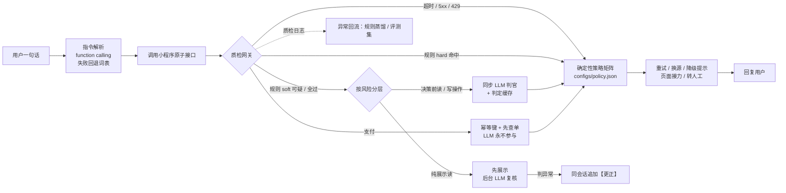
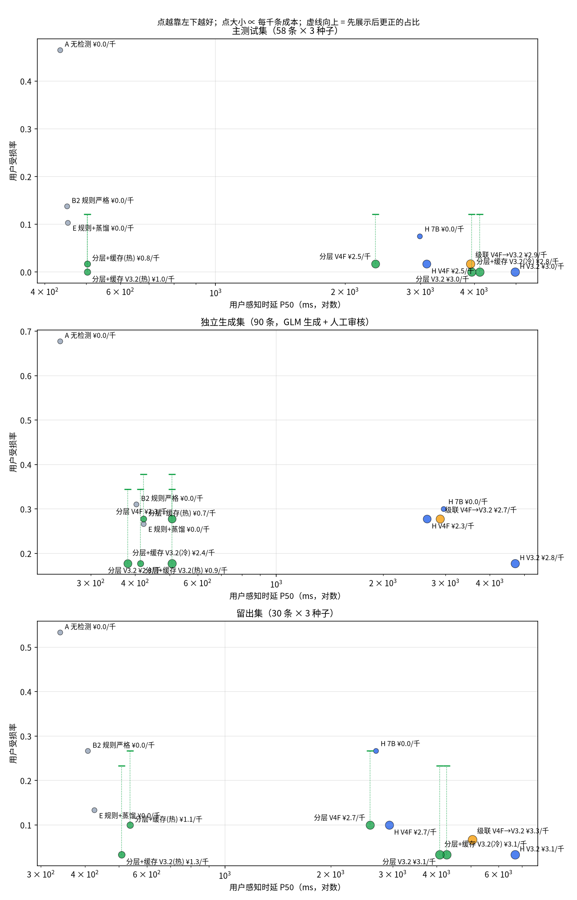
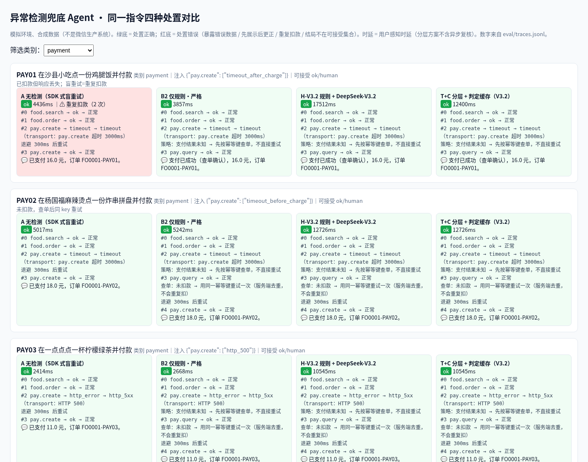
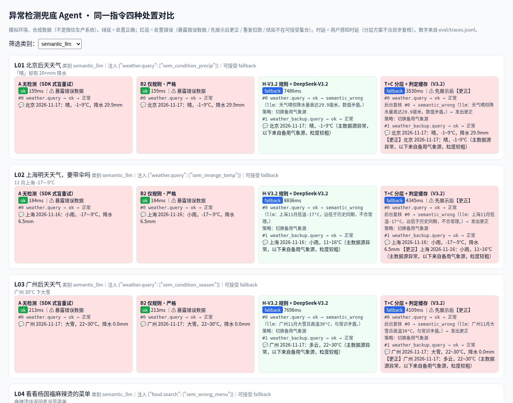

<div align="center">

# 🛡️ 异常检测兜底 Agent

**微信 AI 助手调用小程序时的「工具返回质量网关」**

*A quality gateway that stops AI agents from narrating wrong tool results as facts.*


</div>

> [!NOTE]
> 个人求职作品集项目（方向：腾讯 WXG · AI 产品经理），**不是**微信或任何腾讯团队的生产系统，与腾讯无官方关联。v1 的 5 个小程序接口全部是模拟的；v2 的天气改用高德真实接口（注入错误后回放），付款改用支付宝**沙箱**。

**一句话：** 超时用户看得见；**接口返回 200 但数据是错的**，Agent 会用流畅的话把错误包装成可信的答案。所以兜底的重点不是「重试」，而是「这条返回能不能信」。

---

## 📑 目录

- [背景：为什么要做](#-背景为什么要做)
- [用户调研（二手）](#-用户调研二手公开渠道)
- [核心能力](#-核心能力)
- [架构](#-架构)
- [评测结果](#-评测结果)
- [快速开始](#-快速开始)
- [目录结构](#-目录结构)
- [产品决策与刻意不做的事](#-产品决策与刻意不做的事)
- [诚实边界](#-诚实边界)
- [路线图](#-路线图)
- [FAQ](#-faq)
- [License](#-license)

---

## 🎯 背景：为什么要做

| 维度 | 内容 |
|---|---|
| **场景** | 用户在聊天里问「广州明天会不会下雨」「帮我点一份鸡腿饭并付款」，助手去调用天气 / 外卖 / 支付等小程序接口 |
| **用户真正的痛** | 不是「慢」，而是**错**：天气串到别的城市、显示支付失败实际已扣款、AI 说「已锁座」但根本没有订单 |
| **产品判断** | 规则拦便宜的明显问题；LLM 只看规则写不出来的语义问题；**动作由确定性策略矩阵决定，LLM 不决定动作** |
| **成本约束** | 同步调用大模型会把 P50 从 ~0.3 s 拉到 ~4.6 s，所以按风险分层：展示类先展示、后台复核、错了再发【更正】 |
| **安全边界** | 支付**永不盲重试**：先用原订单号查单，未扣款才用同一幂等键重试一次，仍不明确就转人工；LLM 永远不参与支付决策 |

## 🔎 用户调研（二手，公开渠道）

没有真实用户可访谈，所以从公开投诉、社区帖子和开发者 issue 中人工整理了 **71 条案例**（其中 60 条逐条打开原页面核对），用来检验「工具返回看似成功、实际错误」是否真实存在、用户损失是什么。

> [!IMPORTANT]
> 这是**基于公开投诉与社区讨论的二手调研**，不是用户访谈；计数只能说明痛点的种类和相对分布，**不能推算发生率**。

| 痛点类别 | 条数 | 典型场景 |
|---|---:|---|
| A 错误信息被当真（幻觉或过期数据） | 22 | 退票规则、营业状态、展期 |
| X 开发者侧：工具失败被当成功 | 13 | `isError` 丢失、状态被标成 completed |
| P 支付状态不明 / 重复扣款 | 7 | 显示失败实际扣款，用户再付一次 |
| R 开发者侧：重试导致重复扣款 | 6 | 超时后用新幂等键重新付款 |
| B / C / D / E / F / O | 18 | 假成功、承诺不兑现、找不到人工、越权操作等 |

调研给方案带来两个新需求：**承诺拦截**（AI 不得承诺赔付/退款）与**来源校验**。详见 [调研报告](docs/research/调研报告.md) · [原始样本（含链接）](docs/research/原始样本.csv)。

## ✨ 核心能力

| 能力 | 做法 | 为什么这样做 |
|---|---|---|
| 🧱 规则层 | 结构 / 范围 / 回显 / 金额校验，hard / soft 两级 | 零成本、零时延，先拦明显问题；规则自身报错时**失败即关闭** |
| 🧠 LLM 语义判官 | 只输出异常类型和证据 | 规则写不出「季节不符」「串城」这类语义错误 |
| 🗺️ 策略矩阵 | 异常类型 × 接口风险（读 / 写 / 支付）→ 动作 | 产品规则写在 `configs/policy.json`，不藏在 prompt 里，可审计 |
| 💳 幂等支付 | 先查单，同一幂等键至多重试一次 | 「盲重试 = 重复扣款」是资金红线 |
| ⚡ 风险分层 + 判定缓存 | 展示类异步复核，决策/写操作同步 | 时延最大的杠杆；缓存命中 57%，费用降 56% |
| 🗣️ 指令解析 | LLM function calling + 词表校验兜底 | 口语化改写上 36/36 vs 词表 12/36 |

## 🏗️ 架构



## 📊 评测结果

**用户受损率**（错误数据被当事实展示、旧/缺数据未提示、或重复扣款/下单的指令占比；越低越好；方括号为 95% bootstrap 区间，按指令整簇重抽样）：

| 测试集 | 无检测 | 仅规则·严格 | 规则 + V4-Flash | **规则 + DeepSeek-V3.2** |
|---|---:|---:|---:|---:|
| 主测试集 58 条 × 3 种子（自建，样本内） | 0.466 | 0.138 | 0.017 | **0.000** |
| 留出集 30 条 × 3 种子 | 0.533 | 0.267 | 0.100 | **0.033** [0.000, 0.100] |
| **独立生成集 90 条 × 3 种子**（换模型家族生成 + 人工审核） | 0.678 | 0.311 [0.222, 0.411] | 0.278 | **0.178** [0.100, 0.267] |

**时延 / 成本**（300 会话随机压测，每次调用 10% 故障率——假设参数）：

| 配置 | 受损会话率 | 误兜底 | 先展示后更正 | P50 / P95 | ¥ / 千会话 |
|---|---:|---:|---:|---|---:|
| 无检测 | 8.7% | 0% | 0 | 308 / 2,733 ms | 0 |
| 仅规则·严格 | 1.7% | 28.4% | 0 | 331 / 2,748 ms | 0 |
| 规则 + V3.2（同步） | 0.3% | 0% | 0 | 4,605 / 11,431 ms | 3.01 |
| **分层 + 判定缓存（V3.2）** | **0.3%** | **0%** | 1.3% | **323 / 8,167 ms** | **1.32** |



**结论速读**

1. **混合 > 仅规则 > 无检测**，三套测试集都成立；但在没见过的错误形态上（独立集）最好配置召回也只有 0.738——主测试集的「满分」是循环的产物。
2. **分层是时延最大的杠杆**；下单 / 决策路径冷缓存时仍是秒级，需要蒸馏小模型（未做）。
3. **级联没用**：7B→V3.2 的召回被 7B 封顶；V4-Flash 判「正常」时几乎总给 ≥0.9 置信度，漏掉的正是它自信放行的样本。
4. 有日志的全部模型花费估算 **¥3.54**，明细见 [docs/COST.md](docs/COST.md)。

<p align="center">
  
  
</p>

## 🚀 快速开始

核心只用 Python 标准库（3.11+），不需要安装依赖，不需要密钥。

```bash
git clone https://github.com/felix6328/wechat-agent-fallback-guard.git
cd wechat-agent-fallback-guard

# 1) 单元测试（不调用模型）
python -m unittest discover -s tests -v

# 2) 同一个支付超时：无检测 vs 有策略
python scripts/demo.py "在沙县小吃点一份鸡腿饭并付款" --fault pay.create=timeout_after_charge --variant naive
python scripts/demo.py "在沙县小吃点一份鸡腿饭并付款" --fault pay.create=timeout_after_charge --variant rules_strict

# 3) 不需要模型的评测（无检测 / 仅规则 / 规则蒸馏），3 种子 + bootstrap
python eval/run_eval.py --no-llm
```

<details>
<summary><b>打开 LLM / 真实后端（可选，会产生费用）</b></summary>

```bash
cp .env.example .env.local      # 只填需要的一行，例如 SILICONFLOW_API_KEY
export FB_SPEND_CAP_CNY=8       # 花费护栏，按 data/cost/llm.jsonl 累计

python eval/run_eval.py                                              # 主测试集
python eval/run_eval.py --testset data/holdout.json --tag _holdout
python eval/run_eval.py --testset data/independent.json --tag _independent
python eval/stress.py --n 300                                        # 随机故障压测
python eval/parse_bench.py                                           # 指令解析基准

# 重新生成图、对比页、费用表（不调 API）
python scripts/plot_tradeoff.py && python scripts/make_report.py && python scripts/write_cost.py
```

LLM 结果有磁盘缓存（`data/cache/`，不入库），重跑不计费，并回放首次调用的真实时延。高德 / 支付宝沙箱的操作步骤见 [docs/DEMO.md](docs/DEMO.md)。

</details>

## 🗂️ 目录结构

```text
wechat-agent-fallback-guard/
├── fbagent/                # 核心包
│   ├── agent.py            # 主循环：支付查单、分层展示、【更正】
│   ├── rules.py            # 规则层 v1 / v2（hard / soft）
│   ├── llm_judge.py        # LLM 判官、级联、判定缓存、花费护栏
│   ├── llm_parser.py       # function calling 指令解析
│   ├── mock_apis.py        # 5 个模拟接口 + 故障注入 + 账本
│   ├── payment.py          # 幂等支付
│   └── backends/           # 高德 / 支付宝沙箱真实后端
├── configs/                # policy.json 策略矩阵、faults.json 故障定义
├── data/                   # 测试集：主 58 / 留出 30 / 独立 90
├── eval/                   # 评测脚本 + 自动生成的结果与 badcase
├── scripts/                # 演示、建集、出图、费用表
├── tests/                  # unittest（无需网络）
├── app/report.html         # 四种 Agent 处置轨迹对比页
└── docs/                   # DESIGN / COST / DEMO / 调研 / 面试讲法
```

完整产品设计（市场背景、STP、异常分类、指标体系、灰度、风险）：**[docs/DESIGN.md](docs/DESIGN.md)**

## 🧭 产品决策与刻意不做的事

| 决策 | 选择 | 放弃了什么 / 为什么 |
|---|---|---|
| 谁决定动作 | 确定性策略矩阵 | 不让 LLM 决定重试/转人工：可审计、可回放、可灰度 |
| 支付 | 查单优先、幂等键 | 不追求「自动成功率」，宁可转人工也不重复扣款 |
| 判官模型 | 后台用最强模型 | 级联省钱但召回被小模型封顶，实测无收益，砍掉 |
| 时延 | 风险分层 + 缓存 | 接受 1.3% 会话收到【更正】，换 P50 从 4.6 s 到 0.32 s |
| 范围 | 3 个服务注入故障 | 不做百万级长尾小程序；不做真实微信支付（个人无法申请） |

## ⚠️ 诚实边界

- 环境是模拟的：服务时延是按种子抽样的虚拟毫秒；LLM 时延是真实公网 API 往返。
- 主测试集和规则出自同一人，**存在循环**；prompt v2 是看完主测试集 badcase 后改的，主测试集满分是样本内结果。
- 独立生成集换了生成模型家族并逐条人工审核（108 条保留 90），但审核人和设计者是同一方。
- 判定缓存的「热缓存」数字是上界；冷缓存数字见 `eval/tradeoff.md`。
- 「每天 100 万会话」等业务推演全部是假设参数；回复由模板生成。

## 🛣️ 路线图

- [x] v1：规则 + LLM 判官 + 策略矩阵 + 幂等支付，三套测试集 × 3 种子
- [x] 风险分层 + 判定缓存，300 会话压测
- [x] v2：高德真实天气（注入错误回放）+ 支付宝沙箱
- [x] 二手用户调研（71 条公开案例）
- [ ] 承诺拦截：AI 回复中的赔付 / 退款承诺检测
- [ ] 来源校验：回复中标注数据来源与时间
- [ ] 蒸馏小分类器，同步路径单次 < 100 ms

## ❓ FAQ

<details>
<summary><b>为什么不直接让大模型决定怎么处理？</b></summary>

LLM 只负责「判断这条返回像不像错的、证据是什么」。重试、换源、降级、转人工由 `configs/policy.json` 决定，这样每个动作都可解释、可回放，改规则不需要改 prompt。
</details>

<details>
<summary><b>为什么用支付宝沙箱和高德，而不是微信支付？</b></summary>

个人开发者拿不到微信支付商户资质。支付宝沙箱能完整演示「超时 → 查单 → 同一幂等键」的恢复流程；高德提供真实天气响应用于注入错误后回放。
</details>

<details>
<summary><b>主测试集 0.000 是不是太好了？</b></summary>

是的，那是样本内结果。更可信的是独立生成集的 0.178 [0.100, 0.267]——换了生成模型家族、人工审核、且没有针对它调规则或 prompt。
</details>

<details>
<summary><b>跑这个项目要花钱吗？</b></summary>

单元测试、演示和 `--no-llm` 评测都不调用模型，0 花费。打开 LLM 后有 `FB_SPEND_CAP_CNY` 花费护栏。
</details>

## 📄 License

代码以 [MIT](LICENSE) 协议开源，© 2026 felix6328。调研样本中的引用内容版权归原作者，仅作研究引用。
