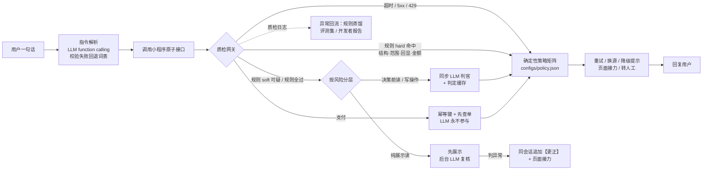

# 异常检测兜底 Agent｜微信 AI 助手调用小程序时的「工具返回质量网关」

> **English summary.** A portfolio prototype (not a Tencent/WeChat production system; all services and data are simulated) of a *tool-response quality gateway* for an AI assistant that calls third-party mini-program APIs. Timeouts are visible to users; the dangerous failure is an API that returns **200 OK with wrong data**, which an agent then narrates fluently as fact. The gateway combines cheap deterministic rules, an LLM semantic judge for what rules can't express, and a deterministic policy matrix (retry / switch source / degrade with disclosure / hand off to the mini-program page / human), with idempotent, query-first handling for payments. Evaluated on three test sets (58 hand-written, 30 held-out, and 90 cases generated by a *different* model family and hand-reviewed) × 3 seeds with bootstrap CIs: user-harm rate drops from 0.68 (no checks) and 0.31 (rules only) to **0.18** (rules + DeepSeek-V3.2) on the independent set. Risk-tiered async checking plus a verdict cache cut perceived P50 latency from ~4.6 s to **0.32 s** in a 300-session stress test at the same harm rate, at the cost of 1.3% of sessions receiving a follow-up correction. Small-model cascades did not help. Pure Python stdlib; all numbers come from real runs (total model spend ≈ ¥3.6).

个人作品集项目，为投递「腾讯 WXG｜AI 产品经理」而做。**不是**微信或任何腾讯团队的生产系统；5 个小程序接口全部是模拟的，商户、价格、天气是固定种子合成的数据。

**一句话产品观：超时用户看得见，数据错了 Agent 会用流畅的话把错误包装成可信的答案。所以质检的重点不在重试，而在「这条返回能不能信」。规则拦便宜的明显问题，LLM 看规则写不出来的语义问题，动作由确定性的策略矩阵决定；支付永远不盲重试。**

- 完整产品设计（一页摘要、市场背景与出处、STP、PMF 假设、异常分类、策略矩阵、指标体系、成本 vs 体验、可扩展性、时延方案、灰度、风险）：**[DESIGN.md](DESIGN.md)**
- 面试讲法：**[面试讲法.md](面试讲法.md)**　费用明细：**[COST.md](COST.md)**

## 架构



## 结果（实测，2026-11-15）

**用户受损率**（错误数据被当事实展示，或旧/缺数据未提示，或重复扣款/下单的指令占比；越低越好；方括号为 95% bootstrap 区间，按指令整簇重抽样）：

| 测试集 | 无检测 | 仅规则·严格 | 规则 + V4-Flash | **规则 + DeepSeek-V3.2** |
|---|---|---|---|---|
| 主测试集 58 条 × 3 种子（自建，prompt v2 样本内） | 0.466 | 0.138 | 0.017 | **0.000** [0.000, 0.000] |
| 留出集 30 条 × 3 种子 | 0.533 | 0.267 | 0.100 | **0.033** [0.000, 0.100] |
| **独立生成集 90 条 × 3 种子**（GLM-4.5-Air 生成 + 人工审核） | 0.678 | 0.311 [0.222, 0.411] | 0.278 | **0.178** [0.100, 0.267] |

**时延 / 成本**（用户感知时延 = 解析 + 服务 + 退避 + 同步 LLM；300 会话随机压测，每次调用 10% 故障率——假设参数）：

| 配置 | 受损会话率 | 误兜底（正常会话） | 先展示后更正 | P50 / P95 | ¥ / 千会话 |
|---|---|---|---|---|---|
| 无检测 | 8.7% | 0% | 0 | 308 / 2,733ms | 0 |
| 仅规则·严格 | 1.7% | 28.4% | 0 | 331 / 2,748ms | 0 |
| 规则 + V3.2（同步） | 0.3% | 0% | 0 | 4,605 / 11,431ms | 3.01 |
| **分层 + 判定缓存（V3.2）** | **0.3%** | **0%** | 1.3% | **323 / 8,167ms** | **1.32** |


几个结论（细节见 DESIGN.md §8、§11、§12）：

1. **混合 > 仅规则 > 无检测，在三套测试集上都成立**；但在没见过的错误形态上（独立集），最好的配置召回也只有 0.738——第一版主测试集上的「满分」确实是循环的产物。
2. **分层（展示类先展示、后台复核、错了发【更正】）是时延最大的杠杆**；判定缓存在压测里命中 57%，费用降 56%。下单 / 决策路径仍要同步等 LLM，冷缓存时仍是秒级，要靠蒸馏小模型（未做）。
3. **级联没用**：7B→V3.2 的召回被 7B 封顶；V4-Flash 判「正常」时几乎总给 ≥0.9 的置信度（三套测试集 × 3 种子只有 9 次因低置信升级），漏掉的正是它自信放行的样本。异步之后判官的时延不再是体验成本，后台应该用最强的模型。
4. **指令解析**：LLM function calling（V4-Flash）在 36 条口语化改写上 36/36，词表 12/36；保留词表做兜底（`eval/parse_results.md`）。

同一指令、四种 Agent 的处置轨迹对比（`app/report.html`，可按类别筛选；红底 = 处置错误）：


## 快速开始

只用 Python 标准库（3.11+，开发时 3.13.5），不需要安装依赖。

```bash
git clone <this repo> && cd <repo>

# 1. 单元测试（不调用模型）：永不重复扣款、LLM 挂了自动回退、级联、判定缓存、异步更正、解析兜底、失败即关闭……
python -m unittest discover -s tests -v

# 2. 命令行演示：同一个支付超时，无检测 vs 有策略
python scripts/demo.py "在沙县小吃点一份鸡腿饭并付款" --fault pay.create=timeout_after_charge --variant naive
python scripts/demo.py "在沙县小吃点一份鸡腿饭并付款" --fault pay.create=timeout_after_charge --variant rules_strict

# 3. 不需要模型的评测（无检测 / 仅规则 / 规则蒸馏），3 个种子 + bootstrap 区间
python eval/run_eval.py --no-llm

# 4. 打开 LLM：只需要 SILICONFLOW_API_KEY 一行（见 .env.example），放进 .env.local，
#    或用 FB_ENV_FILE 指向已有文件；加载器只解析这一行，不读同文件里的其它变量。
#    FB_SPEND_CAP_CNY 是花费护栏（默认 8 元，按 data/cost/llm.jsonl 累计）。
python eval/run_eval.py                                                   # 主测试集
python eval/run_eval.py --testset data/holdout.json --tag _holdout        # 留出集
python eval/run_eval.py --testset data/independent.json --tag _independent
python eval/stress.py --n 300                                             # 随机故障压测
python eval/parse_bench.py                                                # 指令解析基准
python scripts/demo.py "广州后天天气" --fault weather.query=sem_condition_season --variant hybrid --async-display

# 5. 重新生成图、对比页、费用表（不调 API）
python scripts/plot_tradeoff.py && python scripts/make_report.py && python scripts/write_cost.py
```

LLM 结果有磁盘缓存（`data/cache/`，不入库），重跑不计费，并**回放首次调用的真实时延**。

## 必须先读的诚实边界

- 环境是模拟的：服务时延是按种子抽样的虚拟毫秒；LLM 时延是真实公网 API 往返（并发 6）。
- 主测试集和规则都是我写的，**存在循环**；prompt v2 是看完主测试集 badcase 后改的，主测试集满分是样本内结果。
- 独立生成集换了生成模型家族并逐条人工审核（`data/gen_review.json`：108 条保留 90、剔除 18、改标 3），但审核人和设计者是同一方；只为它修了一个崩溃（规则层失败即关闭），没有按它加规则或改 prompt。
- 判定缓存的「热缓存」数字是上界（测试集重复度高）；冷缓存数字也列在 `eval/tradeoff.md`。
- 「10% → 3%」、每天 100 万会话等业务推演全部是假设参数（DESIGN.md §10.2）。
- 回复是模板生成；「页面接力」「转人工」只是结局标签。

## 代码导读

| 文件 | 作用 | 设计理由 |
|---|---|---|
| `fbagent/mock_apis.py` | 5 个接口 + 故障注入 + 账本 | 故障真值只记在 `Env.gt`，Agent 看不到；支付和下单有服务端幂等，这样才能测出「盲重试 = 重复扣款」；支持整段返回体覆盖（独立生成集） |
| `fbagent/rules.py` | 规则层 v1 / v2 | hard / soft 两级；soft 交 LLM 裁决；v2 是从 LLM 判例蒸馏的两条规则；规则自身报错时失败即关闭 |
| `fbagent/llm_judge.py` | LLM 判官、级联、判定缓存、花费护栏 | **只输出异常类型和证据，不决定动作**；磁盘缓存回放真实时延；`VerdictCache` 是产品侧缓存（命中 0 时延） |
| `fbagent/llm_parser.py` | function calling 指令解析 | 输出必须通过词表校验，失败回退词表 |
| `configs/policy.json` | 策略矩阵 | 异常类型 × 接口风险（读 / 写 / 支付）→ 动作；产品规则写在配置里，不藏在 prompt 里 |
| `fbagent/agent.py` | 主循环 | 支付：超时 → 查单 → 未扣款才用同一幂等键重试一次 → 仍不明确转人工；分层模式下展示类先展示、后台复核、发【更正】 |
| `fbagent/configs.py` | 14 个评测配置 | 变体 × 判官 × 分层 × 缓存 |
| `fbagent/evaluate.py` | 打分 | 调用级识别 + 指令级处置 + 用户受损 + 更正率 + 感知时延；按指令整簇 bootstrap |
| `data/testset.json` / `holdout.json` / `independent.json` | 58 / 30 / 90 条带标签指令 | 每条写明可接受结局和理由（`why`） |
| `scripts/gen_independent.py` + `review_independent.py` | 独立生成集的生成与人工审核 | 审核决定和理由写在代码里，可复查 |
| `eval/results*.md`、`badcases*.md`、`tradeoff.md`、`parse_results.md` | 自动生成的结果与 badcase | DESIGN.md 的所有数字出处 |

## 已知限制

- 只有 3 个服务注入故障，世界很小；真实小程序是百万级长尾。
- 测试集类别比例不代表线上分布；兜底成功率不能直接外推。
- temperature=0 下 3 个种子的 LLM 判定几乎一致（种子间召回标准差 ≤ 0.02）；主要不确定性来自样本量，区间宽度约 ±0.1。
- 同步路径（下单、决策前的读）时延仍是秒级，需要蒸馏小模型（未做）。

## License

[MIT](LICENSE)
